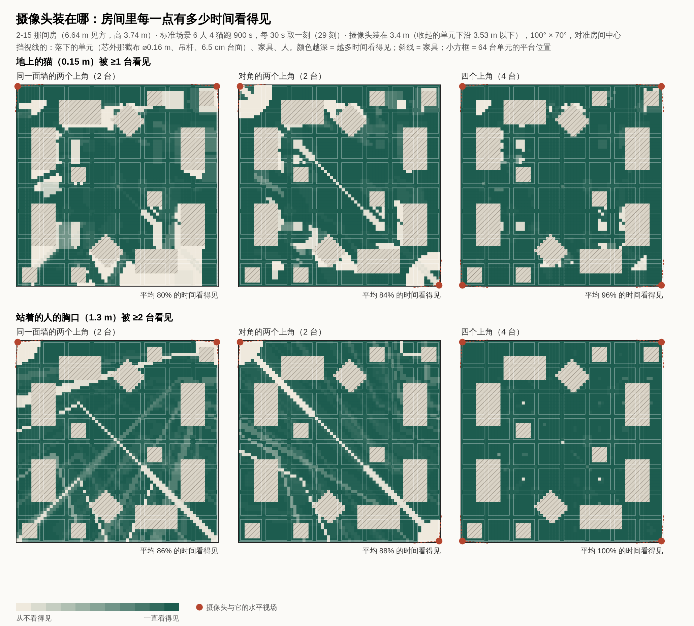
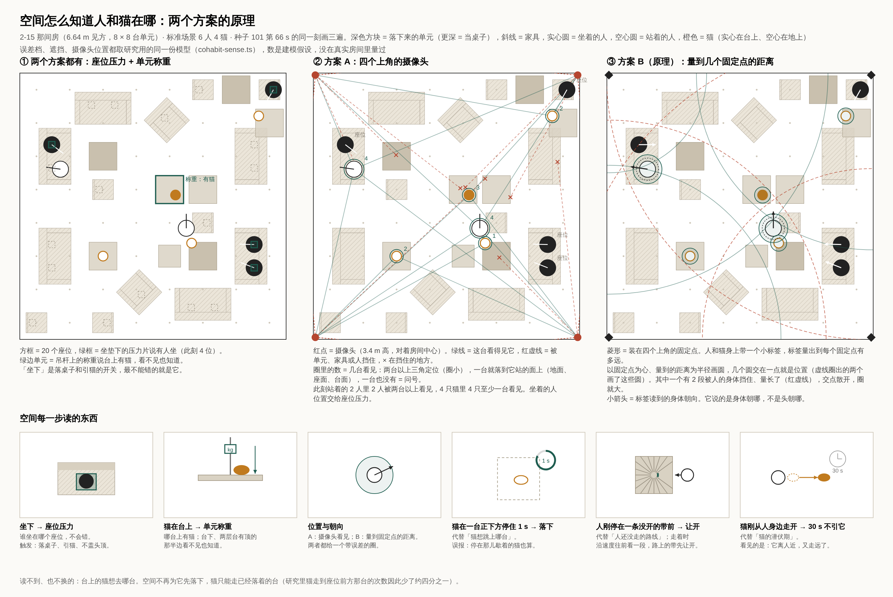
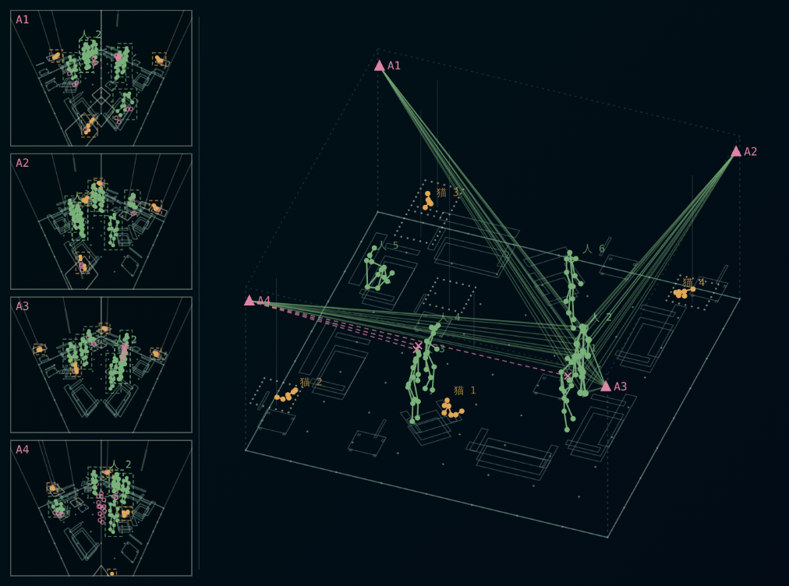
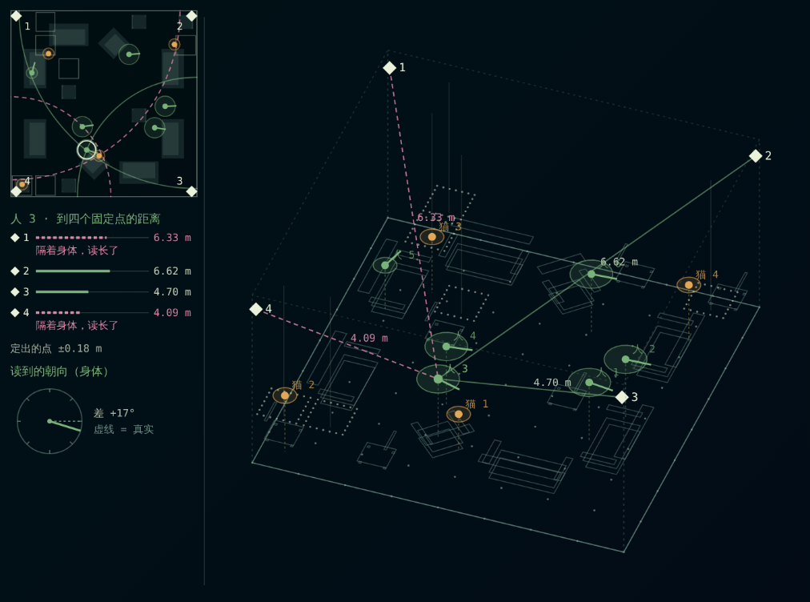
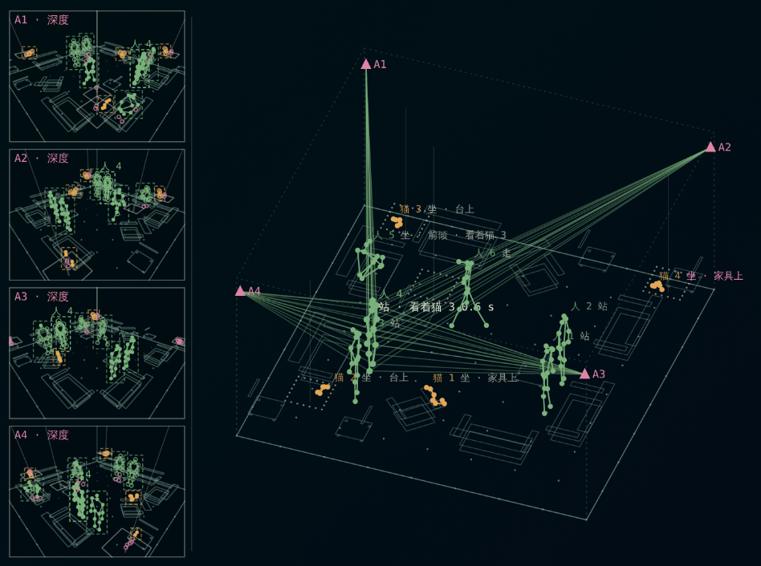

# 项目二 · 感知层：空间凭什么知道人和猫在哪

> 2026-11-18 立项。作者 11-17 提出：「我们做了这些模拟和单元的形变，但始终没有去做 HCI 里面很重要的感知层面……我的建议是在房间上边的两个角各架一台摄像头，两台交叉，就可以识别出猫和人在立体空间里的位置。」看过分析后 11-18 拍板：「摄像头的方案和加上压力 / 重量传感的方案是 OK 的，项圈和胸牌其实也可以，胸牌也能表现这个人此时面朝哪里……两个方案都做。」
> 这份文档回答两件事：一套传感器在 2-15 那间房里实际看得见多少，以及空间改成只读传感器给得出的东西以后，「引导开 − 关」的差值还在不在。
> 代码：`src/lib/space/cohabit-sense.ts`（遮挡几何 · 两个方案的传感器误差 · 读不到的意图换成看得见的量）· 守门 `cohabit-sense.test.ts`（7 项，其中一项现跑 Lab 2-15 的轨迹核对单元竖向尺寸）· `cohabit.ts` 加了可选的 `sense`（省略 = 空间读真值，逐位不变）。研究脚本 `scripts/cohabit-sense/coverage.mjs`（摄像头布置的覆盖率与平面图）、`scripts/cohabit-sense/sense-effect.mjs`（各读法下的引导开 / 关）。产物在 `项目二_感知层/`。
> 状态：模型与研究跑完，站上页面零改。传感器的误差全部是建模假设（§3 逐条写了数从哪来），没有任何一项是在真实房间里量的。

## 1. 结论

- **两台交叉的摄像头不够，四个上角够用。** 两台时站着的人被两台同时看见 76–88% 的时间，地上的猫 32–37%。四个上角到 96% 和 81%（§4）。
- **引导的效果在两个方案下都还在。** 共温「引导开 − 关」：读真值 +12%，摄像头 +11%，胸牌 / 项圈 +11%，都显著，互相之间没有显著差别（§5）。
- **影响最大的是「不读心」，不是传感器误差。** 读不到的四样意图换掉以后，猫到座位前方那台的次数少了约四分之一。传感器误差在这之上没有再拉低结论。
- **最该测准的是谁坐在哪个座位**，座位压力片正好最可靠。头朝向读不准（人只转头、胸牌读的是身体）对主指标几乎没影响。
- **安全要另做。** 换成传感器以后带碰到人的时间是读真值时的 1.3 到 3 倍，单元下落不碰人要靠单元自己的测距和限速，不能靠这一层。

## 2. 空间到底读了人和猫的什么

此前所有研究里，空间每一步直接读人和猫的真实状态。逐条查 `cohabit.ts` 里空间做决定的那几步（`stepSpace` · `tableStep` · `guideStep` · `holdBands` · `requestBands` · R5），读的东西分三类：

| 规则 | 空间读什么 | 现实里能不能测 | 两个方案怎么读 |
|---|---|---|---|
| 坐着：引猫、落桌子 | 谁坐在哪个座位 | 能 | 座位坐垫下的压力片（两个方案一样） |
| 不盖坐着的人头顶 | 坐着的人在哪 | 能 | 同上：座位位置是固定的 |
| 站着看猫：停住满 3 s、看着一只猫（3 m 内、视线 ±25°）就给一步 | 人在不在动、头朝哪、看的是哪只猫 | 能，有误差 | A：摄像头看得到脸按头朝向，看不到脸按身体朝向；B：胸牌里的方向传感（读的是身体朝向） |
| 只收挡路的带 | 人在哪、身体朝向 | 能，有误差 | A：摄像头定位；B：胸牌 UWB 定位 |
| R5：谁都不被困住 | 每个人在哪 | 能，有误差 | 同上 |
| 猫脚下那台保持落着、转移中起落两台都落着 | 猫在哪台上 | 能 | 每台单元吊杆上的称重（两个方案一样） |
| 猫身下的带不收 | 猫在台面上的哪个位置 | 能，有误差 | A：摄像头，看不见就整台护住；B：项圈 |
| 引猫：从猫脚下铺路 | 猫在哪台、地上的猫在哪 | 能，有误差 | 称重 + 摄像头或项圈 |
| 地上的猫要跳上的那台先落 | 猫打算跳上哪台 | 不能 | 换成看得见的：地上的猫在某台正下方（离芯 0.2 m 内）停住满 1 s，就当它要上那台 |
| 台上的猫要去的那台先落（1 s 预备） | 猫打算去哪台 | 不能 | 读不到。空间不为它先落，猫只能走已经落着的台 |
| 引猫时跳过「退开后那段时间」里的猫 | 猫的潜伏期（内部状态） | 不能 | 换成看得见的：看见它刚从一个人身边走开（2 s 前离人不到 1 m，现在远了 0.4 m 以上、挪了 0.3 m 以上），之后 30 s 不引它 |
| 让路：带外缘落在人前方的路线上就收 | 人还没走的路线 | 不能 | 换成看得见的：沿此刻的速度往前直线外推；刚停在一条没开的带前（8 s 内、正前方 0.45 m 处就是墙带）的人，当他要从那里过去 |

最后四行就是 人猫同台lab §14.29 第 7 条记下的「空间读到了现实里感知不到的东西」。任何传感器都读不到意图，所以两个方案都先做了这一步。研究里单独留了一档「只读看得见的」：位置、朝向都按真值，只把这四样换掉，用来区分「不读心」和「传感器有误差」各自的影响。

最后一条（停在带前）是做的时候发现的：换成外推以后，人停在一条没开的带前等，传感器只看得到「人停住了」，看不出他想过去，带就一直不开。试跑里有人被这样关了三到四分钟。补上这一条以后消失。

人和猫自己的行为（走到哪、看谁、什么时候退开）仍按真值。四类事件也按真值记账，真实实验里记账靠录像事后核对，不在实时回路里。

## 3. 两个方案

两个方案共用两样：

- **单元称重**：每台单元的吊杆接一个称重传感器。单元自重是已知常数，多出来的 3–6 kg 就是一只猫上来了，猫在哪台上不会错。两层台有顶的那半边从任何角度都看不见，这一项正好补上。
- **座位压力**：每个座位的坐垫下一片压力片，坐没坐下、坐的哪个座位不会错。「坐下」是落桌子和引猫的触发，最不能错的就是它。

模型里这两样按不会错处理，延迟不计。

### 3.1 方案 A：四个上角的摄像头

| 项 | 取值 | 数从哪来 |
|---|---|---|
| 装在哪 | 四个上角，离地 3.4 m，离墙 5 cm，对准房间中心的地面 | 收起的单元布束下沿离地 3.53 m，摄像头要在它下面（现跑 Lab 2-15 轨迹量的，守门核对） |
| 视场 | 水平 100°、竖直 70° | 常见广角安防镜头的量级，假设 |
| 挡视线的 | 落下的单元：芯外那截布（⌀0.16 m，从钉住端到上夹环）、上夹环以上的吊杆（⌀70 mm）、6.5 cm 的台面；家具（座面、靠背、扶手）；在场的人（⌀0.4 m、站 1.72 / 坐 1.3 m 高的圆柱） | 单元尺寸现跑轨迹量；成形后上夹环 1.43 m，落下途中直垂时 2.13 m |
| 人算看见 | 头或胸被某台看见 | 站着的点：脚 0.08 · 胯 0.9 · 胸 1.3 · 头 1.58 m；坐着：膝 0.5 · 胸 0.95 · 头 1.2 m |
| 人的位置误差 | ≥ 2 台看见：4 cm；1 台看见脚：5 cm（落到地面上）；1 台只看见头：按身高的先验（σ 8 cm）落到头的高度，误差 = 8 cm ÷ tan(俯角)，封顶 40 cm；都看不见：按最后的速度滑行 | 1080p、100° 视场在 9.4 m 处一像素约 8.5 mm，关键点误差几个像素即几厘米；身高先验是假设 |
| 头朝向 | 有一台看得到脸（摄像头在头朝向两侧 60° 以内）：误差 12°；看不到脸只看得见身体：按身体朝向，误差 25° | 假设（头部姿态估计在这个距离上的量级） |
| 猫 | 身体中心或头被看见。≥ 2 台：4 cm；1 台：5 cm（猫在地面或已知高度的台面上，落到那个面上）；台上的猫按它的朝向挪到芯外（立体里猫绕着芯坐） | 同上 |
| 更新 | 每秒 10 次 | 假设 |

### 3.2 方案 B：胸牌与项圈

| 项 | 取值 | 数从哪来 |
|---|---|---|
| 基站 | 四个上角各一个，离地 3.4 m | 与摄像头同位置 |
| 胸牌 | 戴在胸口（站 1.3 m、坐 1.0 m），在身体前表面外一点；按读到的朝向减回身体中心 | — |
| 非视距 | 只算人体挡（自己的身体挡住背后的基站，别人的身体也挡）；布、铝杆、家具按透过算 | UWB 穿布、穿木头家具影响小，人体衰减大，这是常见的经验；铝杆按透过算偏乐观 |
| 位置误差 | 能直视 ≥ 3 个基站：10 cm；2 个：18 cm；≤ 1 个：30 cm | UWB 视距下约 10 cm 的量级（Alarifi 等 2016 综述）；非视距那两档是假设 |
| 项圈 | 离猫所在面 0.2 m，误差同上三档 | 猫贴地、常在人腿之间，非视距更多 |
| 胸牌朝向 | 白噪声 8° + 慢慢漂的偏差（σ 10°，时间常数 60 s） | 室内磁场被 64 台电机和铝杆扰动，方向传感会漂，假设 |
| 更新 | 每秒 10 次 | 假设 |

胸牌读的是身体朝向，不是头朝向。仿真里的人看猫时整个身体转过去（`stepPerson`：看着猫时 heading = gaze），所以胸牌在模型里读得很准。真人多半只转头，这一点模型里没有。研究另跑了一档「人只转头」：胸牌朝向与视线之间加一个 σ 30°、时间常数 10 s 慢慢变的偏差，看这件事对结论的影响有多大。

### 3.3 跟踪

两个方案都是一样的跟踪：α-β 滤波（摄像头 α 0.5 / β 0.15，UWB 噪声大，取 α 0.3 / β 0.04），看不见时按最后的速度滑行、速度每次更新乘 0.7。走没走按估计位置这一秒挪了多远判：人超过 0.3 m/s 算在走，猫低于 0.15 m/s 算停住。一个人进门时按真值起一条轨迹（门口那台摄像头 / 基站看得见），身份从不换号（摄像头方案里两只花色一样的猫靠近时会认错，模型没做）。

## 4. 摄像头装在哪：两台够不够

`node scripts/cohabit-sense/coverage.mjs 项目二_感知层 900 3`：标准场景（6 人 4 猫、引导开、空间读真值）跑三场各 900 s，开场 30 s 之后每 2 s 取一刻（共 1305 刻），数每个人、每只猫此刻被几台摄像头看见。这段时间里平均落着 7.5 台单元。

| 布置 | 站着 / 走着的人：上半身 ≥1 台 · ≥2 台 · 看得到脸 | 坐着的人：上半身 ≥1 台 · 看得到脸 | 地上的猫 ≥1 台 · ≥2 台 | 台上的猫 ≥1 台 |
|---|---|---|---|---|
| 同一面墙的两个上角（2 台） | 96% · 76% · 44% | 100% · 66% | 76% · 32% | 100% |
| 对角的两个上角（2 台） | 99% · 88% · 55% | 100% · 84% | 82% · 37% | 100% |
| 四个上角（4 台） | 99% · 96% · 83% | 100% · 99% | 93% · 81% | 100% |
| 四个角，装在 2.4 m（4 台） | 99% · 96% · 82% | 100% · 96% | 94% · 81% | 100% |
| 四面墙的中点（4 台） | 99% · 99% · 88% | 100% · 93% | 91% · 77% | 99% |
| 四角加四面墙中点（8 台） | 99% · 99% · 95% | 100% · 100% | 95% · 94% | 100% |



读法：
1. **两台交叉，三角定位只在一部分时间成立。** 立体位置要两台同时看见。站着的人被两台同时看见：同一面墙的两角 76%，对角 88%。地上的猫只有 32–37%。一台看见时也能定位，前提是知道它站在哪个面上（地面、座面、台面），这个前提在这间房里大多成立，所以「两台交叉」不是必须的，「每个地方至少一台看得见」才是。
2. **对角比同一面墙好**，但两台都不够：同一面墙的两角，离摄像头远的那一侧被沙发挡住，地上的猫 20% 以上的时间谁也看不见（平面图左下那片浅色）。
3. **四个上角是合适的起点。** 人被两台看见 96%，地上的猫被一台看见 93%、两台 81%。从 2 台到 4 台的提升远大于从 4 台到 8 台。
4. **装高装低差不多**（3.4 m 与 2.4 m 几乎相同）。装在 3.4 m 的唯一理由是不进人的头顶空间、也不碍事。
5. **看脸最难。** 头朝向要靠脸，脸只有摄像头在人前方时才看得到。四台时站着的人 83% 的时间有一台看得到脸，加到八台才到 95%。「站着看猫」那条规则对这个最敏感（§5）。
6. **装在墙角时，正对房间中心那条视线正好穿过对角线上的一排单元。** 平面图里从摄像头斜着出去的那条浅色细线就是一排吊杆和芯挡出来的盲带。四台时别的摄像头补上了。
7. **台上的猫几乎总看得见**（从上往下看台面不受遮挡）。它在哪台本来就由称重给出，摄像头只用来定它在台面上的位置。两层台有顶的那半边模型里没有建（§8），那里是摄像头真正看不到的地方，靠称重。

建模时查出一件事，顺带记下：平面模型里地上的猫不避家具，近一半时间站在沙发、椅子占的位置上。立体里这就是它上了家具，所以这里把它放在家具顶面上。放在地面上算的话，地上的猫只有 40–50% 的时间看得见，那是模型的口径问题，不是摄像头的问题。

## 5. 换成传感器以后，引导还管不管用

`node scripts/cohabit-sense/sense-effect.mjs run 1800 8 <part.json>`（`SEED0` = 100 / 108 / 116 / 124 分四段并行）再 `merge`：标准场景 6 人 4 猫、一场 1800 s、32 个种子（101–132），每个种子同一份起始布置跑五档读法 × 引导开 / 关。检验与 §14.30 相同：按种子配对的符号翻转置换检验，dz，差值 95% 自助区间。合并结果存 `项目二_感知层/sense-effect.json`。

**共温（人不在走、猫在他 0.5–1.5 m 内持续 ≥ 2 s，主指标）**

| 读法 | 引导开 | 引导关 | 开 − 关 | 95% 区间 | p | dz |
|---|---|---|---|---|---|---|
| 读真值 | 6801 | 6084 | +717（+12%） | 397 – 1015 | .0002 | 0.78 |
| 只读看得见的 | 6669 | 6132 | +537（+9%） | 278 – 803 | .0003 | 0.70 |
| 方案 A · 摄像头 | 6704 | 6055 | +649（+11%） | 309 – 980 | .0009 | 0.67 |
| 方案 B · 胸牌 / 项圈 | 6794 | 6097 | +697（+11%） | 404 – 1010 | .0001 | 0.80 |
| 方案 B · 人只转头 | 6841 | 6128 | +713（+12%） | 434 – 1044 | < .0001 | 0.80 |

**其余读数（开 − 关）**

| 读法 | 坐着的共温 s | 共触 s | 猫到座位前方那台 次（开 / 关） |
|---|---|---|---|
| 读真值 | +783（+14%，p .0001） | +208（+9%，p .011） | 21.9 / 8.3 |
| 只读看得见的 | +548（+9%，p .0001） | +155（+7%，p .027） | 17.1 / 6.2 |
| 方案 A · 摄像头 | +613（+11%，p .004） | +141（+6%，p .009） | 17.4 / 4.9 |
| 方案 B · 胸牌 / 项圈 | +634（+11%，p .0001） | +207（+9%，p .0008） | 15.5 / 5.0 |
| 方案 B · 人只转头 | +700（+12%，p < .0001） | +257（+12%，p .0002） | 16.0 / 5.8 |

读法：
1. **引导的效果在两个方案下都还在。** 共温「开 − 关」四档都在 +9% 到 +12% 之间、都显著，区间互相重叠。引导开那一档跟读真值比，四档的共温差都不显著（p .31 / .46 / .97 / .82）。按这套误差模型，「会动的单元让人在猫身边停得更久」这个结论不靠空间读心、也不靠完美的定位。
2. **「不读心」比「有误差」影响大。** 位置朝向都按真值、只把四样意图换掉的那一档，差值从 +717 落到 +537。再加上传感器误差，差值没有继续往下掉（摄像头 +649、胸牌 +697，与「只读看得见的」之间的差别在噪声里）。最明显的代价在「猫到座位前方那台」：引导开时 21.9 次落到 15.5–17.4 次（p ≤ .012），原因是台上的猫想去哪台读不到，空间不再为它先落。
3. **头朝向读不准对主指标几乎没影响。** 「人只转头」那一档里，胸牌读「这个人在看哪只猫」的查全率从 91% 掉到 54%，共温差值却没变（+713）。共温主要来自坐着的人引猫，触发它的是座位压力，这是最不会错的那一项。头朝向只用在「站着看猫给一步」那条规则上，它对共温的贡献本来就小。
4. **共触在两个方案下也还显著**（+6% 到 +12%），摄像头那档最低。共触的绝对值在引导开时比读真值少约 100–190 s（摄像头 p .003），猫到座位前方那台的次数少了，离人最近的那几次也少了。

## 6. 代价与读数质量

**代价（人·s，32 个种子平均，一场 6 个人 × 1800 s = 10800 人·s）**

| 读法 | 带碰到人（开 / 关） | 门口等（开 / 关） |
|---|---|---|
| 读真值 | 30 / 27 | 50 / 41 |
| 只读看得见的 | 39 / 38 | 85 / 87 |
| 方案 A · 摄像头 | 46 / 96 | 104 / 120 |
| 方案 B · 胸牌 / 项圈 | 62 / 71 | 138 / 170 |
| 方案 B · 人只转头 | 45 / 55 | 150 / 144 |

「带碰到人」= 站着或走着的人身体圈里伸进一条已经成墙的带（离身体中心不到 0.20 m）。读真值时也有，约占 0.3% 的人·时间。换成传感器以后是读真值时的 1.3 到 3 倍，种子之间差得很大（摄像头那档开 − 关的区间是 −129 到 +11）。「门口等」= 人在没开的带前停着等，换成传感器以后多出 35–130 人·s，一个人半小时里多等 6–21 s，原因是让路改成按速度外推，转弯和刚起步时带开得晚。

**读数质量（引导开那一档）**

| 读法 | 人的位置误差 | 猫的位置误差 | 丢失：人 / 地上的猫 | 「看着哪只猫」查全 / 查准 | 「猫要上这台」查全 / 查准 |
|---|---|---|---|---|---|
| 只读看得见的 | 0 | 0 | 0 / 0 | （按真值） | 64% / 43% |
| 方案 A · 摄像头 | 5.7 cm | 4.2 cm | 1.0% / 5.1% | 93% / 97% | 54% / 36% |
| 方案 B · 胸牌 / 项圈 | 13.0 cm | 7.4 cm | 0 / 0 | 91% / 96% | 33% / 35% |
| 方案 B · 人只转头 | 16.5 cm | 7.4 cm | 0 / 0 | 54% / 87% | 34% / 36% |

位置误差是滤波后的均方根，坐着的人按座位位置（不计）。「猫要上这台」那一行是换成看得见的量以后最弱的一环：在台下停住 1 s 的规则只认出一半左右真要上台的猫，认出来的里面又有六成其实只是停在那里。它对主指标影响不大，因为地上的猫大部分时候走的是引导铺好的那条路。

## 7. 发现

1. **两台交叉的思路对，但这间房要四台。** 两台时人被两台同时看见只有 76–88% 的时间，地上的猫 32–37%，四个上角到 96% 和 81%。房间里的人和猫大多站在已知的面上（地面、座面、台面），一台看见就能定位，所以布置的目标是「每个地方至少一台看得见」，不是「每个地方两台交叉」。
2. **最该测准的是「坐下」，而它最容易测准。** 引导、桌子、不盖头顶这三件都由「谁坐在哪个座位」触发，座位压力片几乎不会错。研究里的主指标对头朝向的误差、甚至对位置误差都不敏感，对「坐」这一项最敏感（这一项两个方案都没加误差，§8）。
3. **单元自己称重，比任何摄像头都可靠地知道猫在哪台上。** 两层台有顶的那半边、猫贴着芯坐的那一侧，摄像头都可能看不见，称重不受影响。
4. **意图读不到，但空间可以改问看得见的问题。** 「猫想上哪台」改成「猫停在哪台下面」、「人要往哪走」改成「人朝哪走、停在哪条带前」、「猫在潜伏期」改成「猫刚从人身边走开」。改了以后引导仍然有效，代价是猫在台上走得少一些（到座位前方那台 −21% 到 −29%）。这四条可以写进规则总表，作为「空间读什么」的正式口径。
5. **安全不能交给这一层。** 感知层下带碰到人的时间是读真值时的 1.3 到 3 倍，种子之间差得很大。单元下落时不碰到人这件事要靠单元自己：下夹环朝下的测距、下落限速（现在 0.08 m/s）、电机堵转就停。这一层在模型里没有做，是实物必须有的。

## 8. 局限

- **误差全是假设。** 摄像头的 4–5 cm、40 cm 封顶，UWB 的 10 / 18 / 30 cm 三档，朝向的 8° / 12° / 25° 与漂移，全是按常见量级给的，没有在任何真实房间里量过。研究能说的是「在这个量级的误差下结论还在」，不是「这套设备能做到」。
- **座位压力与称重按不会错处理**，延迟不计。现实里压力片会被包、外套、猫压到，称重会被人扶着台面干扰。
- **遮挡模型是简化的**：人是圆柱，猫不挡别人，两层台的上台没建（立体里的随机形态不在平面模型里），让路收回的带仍算挡，单元的布按芯半径算。
- **身份不换号。** 摄像头方案里两只花色相同的猫靠近、两个人交错时会认错人，模型里没有。胸牌 / 项圈自带身份，没有这个问题。
- **UWB 只算人体非视距**，64 根铝吊杆、电机按透过算，偏乐观。
- **记账按真值。** 四类事件仍按真实状态记，真实实验里要靠录像事后核对，这一项在研究方法里另说。
- **人看猫时整个身体转过去**是仿真里人的模型，胸牌在这个模型里读得准。「人只转头」那档只是一种敏感性，偏差大小（σ 30°、10 s）是假设。

## 9. 待作者定

1. **用哪个方案。** 两个方案在主指标上没有差别（§5）。摄像头不用访客戴任何东西、能看到脸，但有遮挡、要处理隐私（只在本地算、只留位置不留画面）。胸牌 / 项圈不受遮挡、自带身份，但要访客戴、给猫戴项圈，读不到头朝向。也可以两个都用：摄像头管位置和脸，项圈管猫的身份。
2. **摄像头几台。** 研究支持四个上角，看脸要到八台（四角加四面墙中点）。
3. **§7 第 4 条那四个「看得见的量」要不要写进规则总表**，成为空间读什么的正式口径。写进去以后，Lab 2-14 / 2-15 的台架也要接上感知层（现在只在研究里用）。
4. **案例页要不要写感知层。** 正文目前没有一句讲空间怎么知道人和猫在哪。要写的话，可以放在「技术实现」那节，交代传感器、哪些意图读不到、换成了什么，以及 §5 的结果。
5. **单元下方的测距与限速**要不要在 Blender 机构里画出来（§7 第 5 条）。

## 10. 怎么在站上讲（2026-11-19 方案稿 → 同日落地成 Lab 2-17，见 §10.1）

作者 11-19：「这 A、B 两个方案如何能够可视化的表现出来……方案 B 不用细化到具体是什么设备，只要把原理说出来就行。」先出了一张原理线稿，用标准场景里真实的一刻（种子 101、第 66 s）把同一个房间画三遍：



- **① 两个方案共用的**：座位压力（坐着的座位亮起）、单元称重（台上有猫的那台描边）。
- **② 方案 A**：四个上角的摄像头，每个人、每只猫连到看得见它的摄像头（实线），被挡住的画到挡住它的地方（虚线 + ×），圈的大小 = 误差，圈旁的数 = 几台看见，一台都没有就是问号。坐着的人不画视线，位置交给座位压力。
- **③ 方案 B（只讲原理，不写设备）**：身上带一个小标签，量到四个固定点的距离，以固定点为心画圆，几个圆交在一点就是位置；被人的身体挡住的那一段量得偏长（红虚线圆），交点散开、圈变大；小箭头是标签读到的身体朝向。
- **下面六张小图**：空间每一步读的东西，后三张是换掉意图的规则。

站上的做法（建议，按先后）：

1. **台架**：在实验室里接一台活的平面图，与 Lab 2-14 同一个仿真、同一种画法，加一组「空间读什么：真实的房间 / 方案 A / 方案 B」。A、B 两档把这张线稿的第 ② ③ 幅做成每帧都在动的叠加层；再加一个「左右对照」的看法，左边真实的房间、右边只画空间读到的（带误差圈的点、问号、读到的朝向），读者一眼看出空间看到的和真实的差在哪。鼠标移到一个人或一只猫上只亮它自己的视线或距离圆，免得满屏都是线。六条规则在发生时在画面上标出来（猫在台下停满 1 s 的计时圈、人停在带前那条带让开）。放在 Lab 2-14 加一组控件，还是单开一台，待作者定。
2. **立体（可选，后做）**：Lab 2-15 里在四个上角画出摄像头和视野线，鼠标移到人或猫上时画出视线，看得出挡住视线的是落下来的单元。再往后可以做「每台摄像头看到的画面」，四个小窗各从一个角渲染房间，框出看见的人和猫；这一项最直观，但要多渲染四遍整个房间，留到最后。
3. **案例页**：在「技术实现」一节放一组分镜（同一刻的真实房间 / 方案 A / 方案 B）、六张小图与覆盖率平面图，配几句话讲空间读什么、读不到什么、换成了什么。正文要改，需要作者授权。

线稿脚本 `node scripts/cohabit-sense/explain-draft.mjs [输出目录] [种子]`（挑那一刻、遮挡、误差档都取 cohabit-sense.ts，与研究同一份）。

### 10.1 落地：Lab 2-17（2026-11-19）

作者看过线稿后改了方向：「把它做立体的，有一些平面视图，然后在旁边生成一个低保真、用点抽象化的立体模型……通过这些摄像头去观察其中的人和猫，抽象出一个立体模型，在里面看到它们真正的空间位置。」于是单开一台，放在第八段最后：






- **左边一列**（方案 A）：四台摄像头各自拍到的画面，竖排，按针孔相机从上角往房间中心看。画的只是点和线：地面轮廓、过道交叉点、家具顶面、单元的芯与台面、人和猫的关键点。这台摄像头看见的点画实心，在画面里却被挡住的点画粉色空心，看见的点外面框一个虚线框（就是检测框）。
- **右边**：只用这些读数重建出来的立体模型，可以拖动旋转（往右拖模型跟着手往右转、往下拖看到更多顶面，与别的立体台架一致）、滚轮缩放，底栏三个视角（轴测 / 俯视 / 正视）。人是 15 个点连成的骨架，猫是 7 个点。两台以上看见的点画实心（定得住）；只有一台看见的点画成空心点加沿那条视线的一小段（只知道在这条线上）；一台都没看见的点留一个淡影 1.5 s 后消失，整个身体都看不见时标问号。指针停在谁身上（或没有指针时台架每 4 s 轮着点名一个）就画谁的视线，被挡的那条画到挡住的地方打 ×。「叠上真实位置」勾上后叠一副灰色虚线骨架，看得出差在哪。
- **方案 B**（只讲原理，不写设备）：左边换成俯视图和一张读数表——选中的那个身体到四个固定点各量出多远，条长按距离，隔着别人身体量的那条画粉色虚线、写「隔着身体，读长了」，下面写定出来的误差；人再加一个朝向盘（实线 = 读到的身体朝向，虚线 = 真实）。右边每个身体一个点，带误差圈、落到地面的竖线和读到的朝向，选中的那个连到四个固定点并标距离。
- **场景**：实验 2-15 那间房、6 位访客、4 只猫，访客节奏取研究那一套（一坐 1.5–4 分钟），画面里才有人走动。仿真本身仍按真实位置走，这台只画传感器读到了什么；空间改读这些读数以后引导还管不管用，就是 §5 那组数。
- **摄像头布置**四档：同墙两台、对角两台、四个上角（默认）、四角加墙中点（多出的四台只在右边画）。切换只换读法，场景不重开。
- 关键点、遮挡、误差都取研究同一份（`cohabit-sense.ts`）：关键点每帧取真实姿态（人形骨架是站上 1.70 m 那副，`figure.ts`），看没看见每 0.1 s 判一次，误差是一个慢慢漂的偏移（时间常数 0.6 s），画面上读得出「抖」而不是「闪」。四个画面是按模型画的，不是真摄像头的成像；逐帧跟住同一个人、分清谁是谁、从关节读出站坐，都假设能做到。

代码：`src/lib/space/sense-view.ts`（关键点、针孔投影、逐台看见 / 被挡、标签距离，守门 8 项）· `src/lib/space/sense-observer.ts`（每帧读仿真、出两套读数）· `components/lab/senseDraw.ts`（2D 画布，逻辑 700 × 520，左 162 宽一列、右边立体）· `components/lab/SenseBench.tsx`（台架）。深链 `/lab#lab2-17-tag`、`#lab2-17-diagonal2` 等。

验证：全套 1563 项测试绿、生产构建过；无头 Chromium 在生产构建上实测中英两侧（英文侧无中文）、画面在动、右边拖动转视角、切方案 B、切对角两台、深链 `#lab2-17-tag`，无 pageerror。实测读数（标准场景第 18 s 左右）：四个上角时站着的人 97% 的点定得住、对角两台 77%；方案 B 十个身体里 4 个能直视三个以上固定点（人自己的身体挡住背后的固定点，与研究同一个设定）。上面两张截图是在生产构建的 `/lab#lab2-17` 上现截的（截图脚本不进仓库）。

### 10.2 两个方案都改成真解算（2026-11-19 同日）

作者看过 10.1：「是不是只用监测到这四个点的距离，就可以通过三角函数之类的方法算出来人真正的空间位置」→「那就把这两个方案都做了：摄像头那个，拿深度相机的话甚至可以直接读到这个人在做什么；距离那个也就这么做。」此前 10.1 的立体模型是「真实位置 + 按看见几台给的误差」，方案 B 的位置也是「真实位置 + 按能直视几个固定点给的误差」，都没真的从读数解回来。这一轮改成真算：

**方案 A，普通摄像头**：每台看见一个关节，就给一条从镜头指向它的视线，带 0.005 rad 的检测误差（约 1920 像素宽、100° 视场下 5 个像素）。两条以上用最小二乘求离几条线都最近的点；只有一条时，只知道它在这条线上，按上一刻的位置落在线上（画成空心点加沿视线的一小段）。

**方案 A，深度相机**：每台还量得到这个点有多远（建模取常见飞行时间深度相机远距档的量级：视场 75° × 65°、0.5–5.5 m、误差 1.5 cm + 距离的 0.4%）。两台以上看见时仍按视线交点（角度比测距准），只有一台看见时用量到的远近定住，超出测距退回成视线。

**读在做什么**（两种摄像头一样，只用解出来的关键点）：
- 人：胯低于 0.71 m（胯没定住时头低于 1.40 m）读成坐；最近一秒躯干挪了 0.3 m/s 以上读成走；坐着时颈比胯往前倾过 12° 读成前倾；人看哪：摄像头看得见脸时按脸（误差 ±12°），否则按两肩连线的法向（±25°，正反按走的方向或上一次读数），这个方向 ±25°、3 m 以内离视线最近的猫算在看——与仿真里「站定看猫」同一条规则。
- 猫：先按读到的位置在房间里找它站的面（地面、家具顶面、此刻成形的台面，这些高度是已知的，挑离读到的高度最近的那个），再按臀、头、颈离这个面多高分站、坐、趴，速度分走。首版用脚那个点定面，脚贴着面、最容易被挡，深度相机下坐着的猫多半读成趴，改成查房间里的面以后读对。
- 每一刻与仿真里的真实情况对照，读错的在台架上标粉色，指针停着的那个另写真实的。

**方案 B**：四段距离各带 0.08 m 误差，隔着身体（别人的或戴的人自己的）量的那段读长 0.35 m；用高斯—牛顿最小二乘解出 (x, y, 高度)，固定点上方那个镜像解丢掉。残差平方和超过 χ²₁ 的 95% 线就标「四段对不上」。坐不坐看座位压力，猫在哪一台看单元称重（方案 B 本来就带这两样）；解出的高度单独画出来对照。



**这间房的几何**（解析算的）：距离量准到 ±10 cm 时，四个上角的固定点给出的水平位置误差约 ±11–13 cm、高度约 ±9–12 cm，四个点在同一高度也解得出高度。四个点只多出一个距离，所以一段读错**看得出有错、看不出是哪一段**：试过逐段去掉重算、再加上座位压力 / 称重给的高度，挑对那一段的比例只有 13–25%，所以台架上只标「对不上」，不去猜是哪一段。

**实测**（`scripts/cohabit-sense/read-accuracy.mjs`：Lab 2-17 那一场，4 个种子 × 600 s，每 0.5 s 记一次，一场仿真同时喂九种读法；结果 `项目二_感知层/read-accuracy.json`）：

| 读法 | 站着的人的点定得住 | 坐着的 | 猫 | 定住的点差（中位 / 90%） | 人：站走坐读对 | 人：在看哪只猫读对 | 猫：姿势读对（看得见时） | 猫看不清 |
|---|---|---|---|---|---|---|---|---|
| 普通 · 同墙两台 | 66% | 46% | 39% | 3.9 / 7.4 cm | 96% | 66% | 93% | 43% |
| 普通 · 对角两台 | 65% | 46% | 37% | 4.0 / 7.0 cm | 97% | 67% | 94% | 47% |
| 普通 · 四个上角 | 91% | 76% | 73% | 3.0 / 5.5 cm | 97% | 83% | 96% | 13% |
| 普通 · 四角 + 墙中点 | 97% | 83% | 86% | 2.1 / 4.2 cm | 97% | 87% | 98% | 3% |
| 深度 · 同墙两台 | 79% | 57% | 52% | 3.8 / 7.2 cm | 96% | 65% | 95% | 34% |
| 深度 · 对角两台 | 77% | 55% | 48% | 3.9 / 6.9 cm | 96% | 66% | 96% | 38% |
| 深度 · 四个上角 | 95% | 74% | 73% | 3.0 / 5.5 cm | 96% | 82% | 96% | 15% |
| 深度 · 四角 + 墙中点 | 98% | 83% | 84% | 2.3 / 4.8 cm | 96% | 86% | 96% | 3% |

| 方案 B | 全直接量到 | 一段隔着身体 | 两段以上 |
|---|---|---|---|
| 占的时间 | 23% | 40% | 37% |
| 水平位置差（中位 / 90%） | 0.08 / 0.15 m | 0.21 / 0.30 m | 0.29 / 0.40 m |
| 高度差（中位 / 90%） | 0.05 / 0.13 m | 0.22 / 0.35 m | 0.33 / 0.50 m |
| 标出「四段对不上」 | 5%（误报） | 41% | 18% |

方案 B 另：坐 / 站 / 走读对 97%（坐靠座位压力），只看解出的高度分坐站只对 74%（隔着身体读长会把点往下拉，站着的人常读低）；猫在地上 / 家具上 / 台上读对 96%。

**读出来的几件事**：
1. **深度相机补的是「只有一台看见」**：两台摄像头时站着的人的点从 65–66% 涨到 77–79%、猫从 37–39% 涨到 48–52%；四台、八台时几乎一样，因为大多数点本来就有两台看见。
2. **「在做什么」里站走坐好读，「在看哪只猫」难读**：站走坐每种布置都约 96%；看哪只猫取决于看不看得见脸、看得见几台，两台约 66%、四台 82–83%、八台 86–87%，**有没有深度都一样**。作者说的「深度相机直接读到人在做什么」在这个模型里体现得不明显——模型假设普通摄像头看得见的关节都检得出，而真的检测器单目常认错关节、深度在这一点上帮得上忙，这一项没进模型。
3. **方案 B 的位置不差，难在被身体挡**：四段都直接量到时 8 cm，与摄像头一个量级；但胸牌戴在身体前面，背后的固定点常被自己挡住，至少一段隔着身体的时间占 77%，这时差 0.2–0.3 m，而且一段读长时只有四成看得出来。研究里方案 B 用的误差档（三点以上 ±0.10、两点 ±0.18、更少 ±0.30 m）与真解算的 0.08 / 0.21 / 0.29 m 对得上，§5 的结论不用改。
4. **方案 B 读不到人在看哪**：胸牌读的是胸口朝向，不是头；读到的「在做什么」只有坐（座位压力）、站、走。

代码：`src/lib/space/sense-solve.ts`（视线求点、深度点、四段距离解位置、读人 / 读猫，守门 11 项）· `sense-observer.ts` 改成真解算（守门 3 项）· `sense-view.ts` 加深度相机与前倾 · 台架「方案」改三档（A 普通摄像头 / A 深度相机 / B 量距离），差分清单 779 → 783（两种摄像头 × 四种布置 + B）。深链 `#lab2-17-depth`、`#lab2-17-tag`。

## 11. 复现

```bash
npx vitest run src/lib/space/cohabit-sense.test.ts
node scripts/cohabit-sense/coverage.mjs 项目二_感知层 900 3
node scripts/cohabit-sense/explain-draft.mjs 项目二_感知层 101
node scripts/cohabit-sense/read-accuracy.mjs 项目二_感知层/read-accuracy.json 600 4   # 约 18 分钟
SEED0=100 node scripts/cohabit-sense/sense-effect.mjs run 1800 8 part-100.json   # 108 / 116 / 124 各一段，可并行
node scripts/cohabit-sense/sense-effect.mjs merge 项目二_感知层/sense-effect.json part-100.json part-108.json part-116.json part-124.json
```

四段并行在 4 核机器上约 20 分钟。在仿真里接感知层：`new CohabitSim({ …, sense: makeSense('camera') })`（或 `'tag'` / `'observe'`），跑完读 `sense.stats`。
